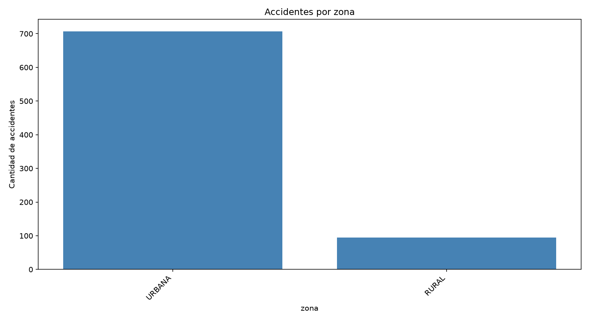
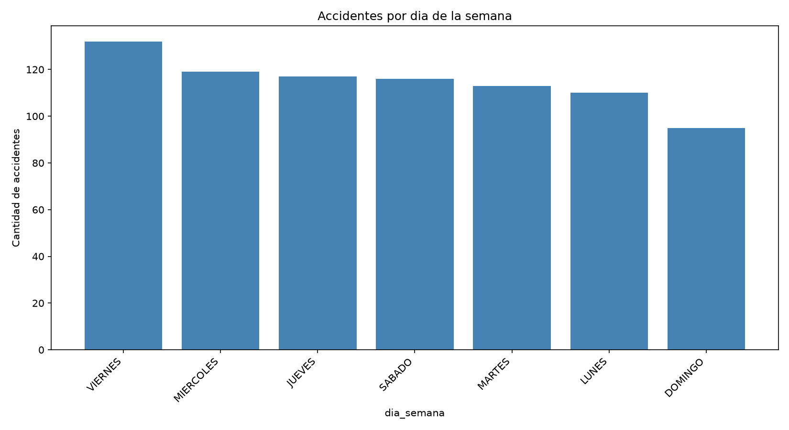
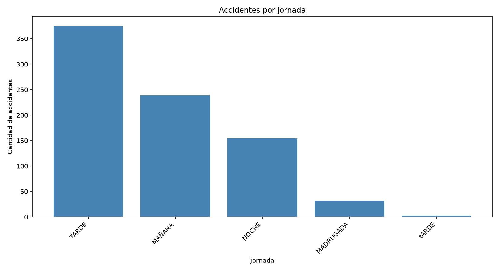
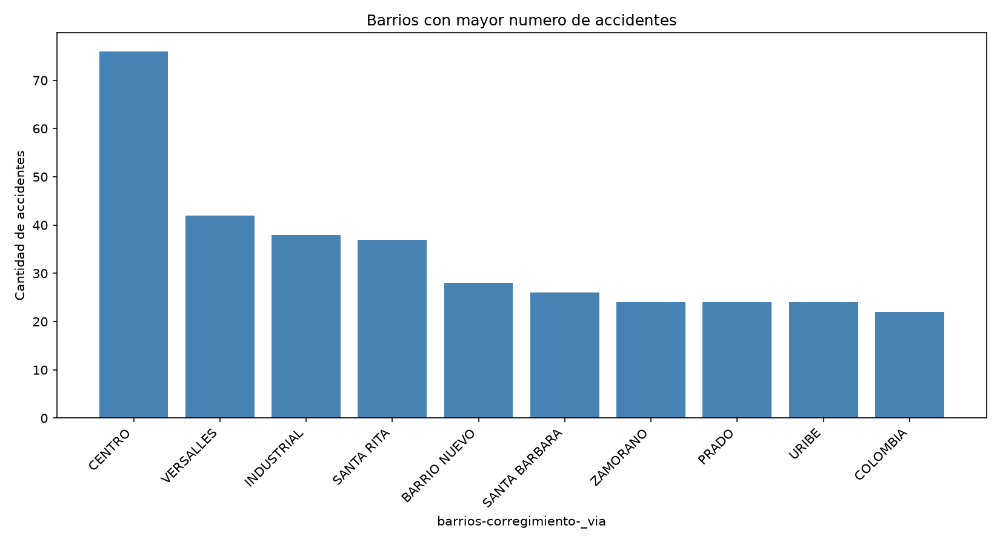

# Análisis de accidentes de tránsito en Palmira con Apache Spark

## Descripción del proyecto

Este proyecto fue desarrollado para la Tarea 3 del curso Big Data de la Universidad Nacional Abierta y a Distancia (UNAD).

Su objetivo es analizar registros de accidentes de tránsito del municipio de Palmira, Valle del Cauca, utilizando Apache Spark y Python.

Se implementan técnicas de procesamiento en batch, limpieza de datos, transformación, análisis exploratorio y visualización de resultados.

## Problema de investigación

Los accidentes de tránsito representan una problemática relacionada con la seguridad vial.

El análisis de registros históricos permite identificar patrones asociados con las zonas, barrios, jornadas y días de la semana en los que se presentan accidentes.

Mediante Apache Spark se procesan los datos publicados por la Alcaldía de Palmira para identificar características relevantes de estos eventos.

## Fuente de datos

- Nombre: Accidentes de tránsito Palmira.
- Entidad: Alcaldía de Palmira, Valle del Cauca.
- Plataforma: Datos Abiertos Colombia.
- Periodo: 2022 y parte de 2023.
- Registros originales: 808.
- Registros después de eliminar duplicados: 802.

Enlace oficial:

https://www.datos.gov.co/d/esbz-zavy

## Tecnologías utilizadas

- Ubuntu 24.10
- Apache Spark 3.5.8
- Apache Hadoop 3.3.6
- Python 3.12.7
- PySpark
- Pandas
- Matplotlib

## Archivos del proyecto

**analisis_accidentes.py**

Programa principal desarrollado con Apache Spark.

Permite cargar el conjunto de datos, identificar sus columnas, eliminar registros duplicados, normalizar nombres y realizar agrupaciones estadísticas.

**graficos_accidentes.py**

Programa desarrollado en Python para generar gráficos a partir de los resultados procesados por Spark.

**Accidentes_de_transito_Palmira_20261026.csv**

Conjunto de datos utilizado para el análisis.

**zona.png, dia.png, jornada.png y barrio.png**

Gráficos generados durante el análisis exploratorio.

## Procesamiento en batch

El procesamiento se desarrolla mediante las siguientes etapas:

1. Carga del conjunto de datos CSV.
2. Identificación del esquema y las columnas.
3. Conteo de registros.
4. Eliminación de registros duplicados.
5. Normalización de los nombres de las columnas.
6. Agrupación de registros por categorías.
7. Cálculo de frecuencias.
8. Exportación de resultados.
9. Generación de gráficos.

## Resultados obtenidos

El conjunto de datos contiene inicialmente 808 registros.

Después de eliminar duplicados se obtuvieron 802 registros.

### Distribución por zona

- Zona urbana: 707 registros.
- Zona rural: 95 registros.

La zona urbana representa aproximadamente el 88,2 % de los registros analizados.

### Barrios con mayor número de registros

- Centro: 76.
- Versalles: 42.
- Industrial: 38.
- Santa Anita: 37.
- Barrio Nuevo: 28.
- Santa Bárbara: 26.

Estos resultados permiten observar una mayor concentración de registros en determinados sectores del municipio.

## Visualización de resultados

### Accidentes por zona



### Accidentes por día de la semana



### Accidentes por jornada



### Barrios con mayor número de accidentes



## Instrucciones de ejecución

### 1. Requisitos

Tener instalados:

- Python 3.
- Apache Spark.
- Pandas.
- Matplotlib.

### 2. Instalar bibliotecas de visualización

```bash
pip install pandas matplotlib
```

### 3. Ejecutar el análisis con Spark

Desde la carpeta donde se encuentran los archivos:

```bash
spark-submit --master "local[2]" --conf spark.hadoop.fs.defaultFS=file:/// analisis_accidentes.py
```

### 4. Generar los gráficos

```bash
python graficos_accidentes.py
```

Los resultados del análisis se almacenarán en la carpeta `resultados_accidentes` y las imágenes en la carpeta `graficos`.

## Conclusiones

El procesamiento en batch mediante Apache Spark permitió organizar y analizar los registros de accidentes de tránsito de Palmira.

La eliminación de duplicados contribuyó a mejorar la calidad de la información utilizada.

Los resultados muestran que la mayoría de los registros corresponde a la zona urbana.

El análisis por barrios permite identificar sectores con mayor concentración de eventos registrados.

Finalmente, la combinación de Apache Spark, Python y Matplotlib facilita el desarrollo de procesos de análisis exploratorio y visualización de datos.

## Referencias

Alcaldía de Palmira. (s. f.). *Accidentes de tránsito Palmira* [Conjunto de datos]. Datos Abiertos Colombia. https://www.datos.gov.co/d/esbz-zavy

Apache Software Foundation. (s. f.). *Apache Spark documentation*. https://spark.apache.org/docs/latest/

## Autor

Harold Santiago Alfonso García

Universidad Nacional Abierta y a Distancia (UNAD)

Ingeniería de Sistemas

Curso: Big Data

Tarea 3 - Procesamiento de Datos con Apache Spark

2026
